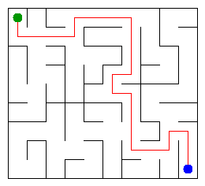

# Assignment 3. Maze Escape

Student ID: 251453
Name: Moldir
Group: SE-2512
Maze size (rows x columns): 9 * 10

This file is the report. Fill it in as you go. How to start: `START_HERE.md`. The task: `docs/Assignment3.pdf`.

## Program output

The 13 lines your program prints on your data (`java -cp out Main`):

    Broken: 89
    Kept: 72
    Last broken wall: 133
    MST cost: 27155
    Heaviest broken wall: 738
    Path length: 23
    DFS visited: 44
    Dead ends: 26
    Zones: 11
    Largest zone: 14
    Is DAG: 0
    Flow stages: 7
    Fastest route cost: 15

My maze:

## Questions

**Mission 0. What do find and union do, and what makes them fast in your code?**

The `find` operation returns the representative of the set containing an element, while `union` joins two sets if they are different. My implementation is fast because it uses path compression and union by size, which keep the trees shallow.

**Mission 1. Why is Broken always R*C - 1, and Kept always (R-1)*(C-1)?**

The maze starts with R*C cells, and a connected maze without cycles needs exactly R*C - 1 broken walls to connect all cells. The total number of walls is R*(C-1) + C*(R-1), so the number kept is the total minus R*C - 1, which equals (R-1)*(C-1).

**Mission 2. My MST cost from Kruskal and from Prim, and why they are equal:**

My MST cost is 27155 using Kruskal, and Prim also calculates the minimum spanning tree cost. They should be equal because both algorithms find a minimum spanning tree of the same weighted graph, although they may select different walls when multiple minimum trees exist.

**Mission 3. Why is there exactly one path between two cells? How did you avoid a stack overflow on a huge maze?**

The maze is a tree: it is connected and contains no cycles, so there is exactly one path between any two cells. I used an explicit stack for iterative DFS instead of recursive calls, avoiding stack overflow on a large maze.

**Mission 4. Why does the second pass of Kosaraju go on the reversed graph? Why do the slides have no cycle exactly when Zones equals the number of cells?**

The second pass uses the reversed graph in decreasing finishing-time order to identify strongly connected components. The slide graph has no directed cycle exactly when every cell is its own strongly connected component, meaning the number of zones equals the number of cells.

**Mission 5. Why is it enough to go through the zones in the order of their numbers? What does this pass cost?**

After strongly connected components are found, the graph of zones is a directed acyclic graph, and the zone numbering gives a topological order. Processing zones in that order lets the algorithm calculate the longest chain and the cheapest route without needing a priority queue.

## AI use

I used ChatGPT to understand algorithm concepts, troubleshoot Java code, interpret checker results, run the benchmark, and help organize this README. I reviewed the explanations and used them to understand my implementation.
## Timing (Mission 7)

Milliseconds, 5 runs each, from `java -cp out Bench`.

| maze | Kruskal | Prim    |
|---|---------|---------|
| 100 x 100 | 15 ms   | 10 ms   |
| 300 x 300 | 79 ms   | 70 ms   |
| 1000 x 1000 | 1200 ms | 1698 ms |

### What do the numbers say about how the time grows? Two or three sentences.

As the maze size increases, the execution time increases for both algorithms. Kruskal is faster on the 1000×1000 maze in my measurements, while Prim is slightly faster on the two smaller mazes. The exact times can vary depending on the computer and the JVM.

## Complexity

n is the number of cells, m is the number of walls (or slides), and z is the number of zones.

| algorithm | time | space | assumptions |
|---|---|---|---|
| DSU find and union | Amortized O(α(n)) per operation | O(n) | Path compression and union by size |
| Kruskal | O(m log m + m α(n)) | O(n + m) | Sorts all walls by cost |
| Prim | O((n + m) log(n + m)) | O(n + m) | Adjacency lists and priority queue |
| DFS | O(n + m) | O(n) | Iterative DFS on the maze graph |
| Kosaraju | O(n + m) | O(n + m) | Both forward and reversed graphs are stored |
| Route in the zone graph | O(zm) | O(z) | Scans all slides for each zone |
## Before you submit

- data/walls.txt, data/slides.txt and output/maze.png are in the repository.
- `java tools/Check.java` shows all examples right.
- This README is filled in, the program output and the section AI use included.
- The work is pushed to main (at least one commit per mission) and the repository is public.
- The link is attached in Moodle.
